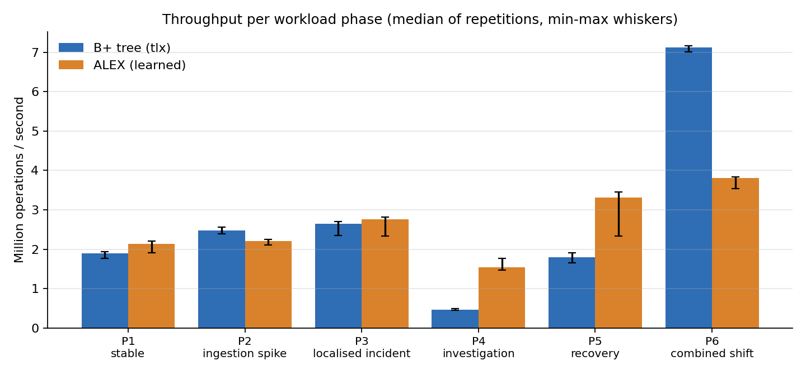
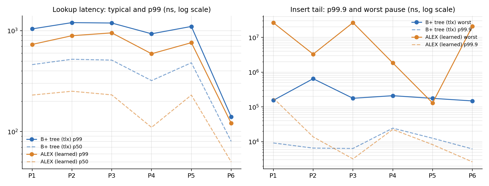
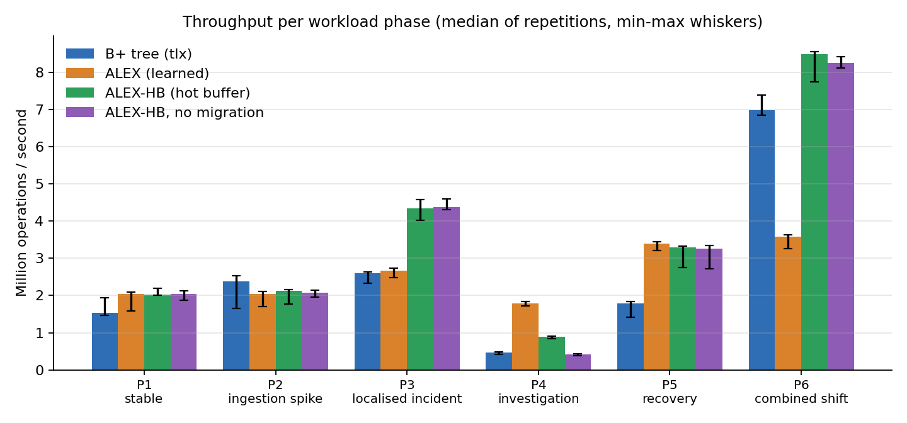

# Innovative Experiment: B+ tree vs learned index under cold-chain workloads

**Finding.** ALEX (a dynamic learned index) answered lookups about twice as fast as a B+ tree. It answered the investigation-phase range scans about 4.6 times faster. But almost all of its insert cost came from rare reorganisations: in three phases, the slowest 1 % of inserts took 80 to 83 % of all insert time, with single pauses of up to about 27 ms (B+ tree worst: 0.65 ms). ALEX also used about twice the memory by the end of the workload.

Full tables for this baseline study: `benchmark/results_baseline/summary.md`; raw data: `benchmark/results_baseline/results.csv`. Section 6 adds a third configuration (ALEX-HB), measured in a later run in `benchmark/results/`.

## 1. Question

Sensor readings in PharmaTrace are keyed by (sensor, time). When a refrigeration unit fails, the workload shifts in three ways:
- a few sensors start reporting much more often;
- investigators query a narrow time window repeatedly;
- later, everything returns to normal.

**Question:** does a learned index keep its advantage over a B+ tree when the data and query distribution shift like this, and what does adapting cost?

This experiment runs outside PostgreSQL. It evaluates the index structures on workloads modelled on the application; it does not change how PharmaTrace's own SQL queries run.

## 2. Setup

| Item | Value |
|---|---|
| Indexes | tlx `btree_map` (B+ tree), commit 2dd63ab; ALEX `alex::Alex`, commit 4370da6 |
| Key | `sensor_id << 40 \| epoch_seconds`, unique and ordered by sensor then time; payload 8 bytes |
| Initial data | 1,000 sensors × 30 days at 5-minute intervals = 8,640,000 keys, bulk-loaded |
| Workload | 6 phases × 1,000,000 operations, generated once (seed 7); both indexes replay identical files |
| Build | g++ 14.4, `-O3 -march=native`, single thread, Docker (WSL2) |
| Machine | AMD Ryzen 5 7535HS, 12 logical cores, 7.5 GB available to Docker |
| Repetitions | 5 per index, each in a fresh process, run order alternated between repetitions |
| Timing | Every operation timed with `steady_clock` (20 ns overhead, included in all latencies) |
| Correctness | Lookup hits and payload checksums were identical for both indexes in every repetition |

| Phase | What it simulates | Mix |
|---|---|---|
| P1 stable | Normal monitoring | 80 % lookups, 10 % inserts (every sensor, 5-min steps), 10 % 1-hour range scans |
| P2 ingestion spike | Many more readings arriving | 60 % inserts, 35 % lookups, 5 % ranges |
| P3 localised incident | 10 failing sensors report every second | 50 % inserts on those sensors, 50 % lookups |
| P4 investigation | Repeated queries on the incident window | Zipf(0.99) over incident readings: 47.5 % lookups, 47.5 % 10-minute ranges, 5 % inserts |
| P5 recovery | Back to normal | Same mix as P1 |
| P6 combined shift | A second failure while it is being investigated | 50 % inserts on 10 new sensors, 50 % lookups of their newest readings |

## 3. Results

Throughput, medians of 5 repetitions, in millions of operations per second:

| Phase | B+ tree | ALEX | ALEX / B+ tree |
|---|---|---|---|
| P1 stable | 1.89 | 2.14 | 1.13× |
| P2 ingestion spike | 2.48 | 2.20 | 0.89× |
| P3 localised incident | 2.64 | 2.76 | 1.04× |
| P4 investigation | 0.46 | 1.53 | 3.30× |
| P5 recovery | 1.80 | 3.31 | 1.84× |
| P6 combined shift | 7.12 | 3.81 | 0.54× |

**Lookups and range scans favour ALEX in every phase.**
- Median lookup latency was 230 ns for ALEX against 461 ns for the B+ tree in P1.
- In the investigation phase it was 110 ns against 320 ns.
- Investigation range scans had a median of 791 ns against 3,607 ns.
- This is the main reason ALEX leads in P4 and P5.

**ALEX's inserts are usually fast but occasionally very slow.**
- Median insert latency was similar or lower for ALEX.
- But in P1, P2, P3 and P6 its worst inserts took 3 to 27 ms, against at most 0.65 ms for the B+ tree in any phase.
- In P1, P3 and P6, ALEX's slowest 1 % of inserts took 80 to 83 % of all its insert time. The B+ tree's slowest 1 % took 15 to 36 %.
- As a result, ALEX's mean insert time was higher than the B+ tree's in P1 (1,877 ns against 395 ns), P2, P3 and P6.

**The pauses coincide with the distribution shifts.**
- ALEX's own counters show adaptation work arriving in bursts: node expansions with re-scaling went from 0 after P1, to 206 after P2, 619 after P3 and 1,008 after P6.
- Retrains followed the same pattern (3, 107, 332, 576).
- In P6, half the operations are inserts into newly hot key ranges, and those pauses cost ALEX half its throughput (0.54×).

**ALEX uses more memory.**

| | After bulk load | After P6 |
|---|---|---|
| ALEX | 190 MB | 510 MB |
| B+ tree | 158 MB | 244 MB |

ALEX keeps gaps in its data nodes for future inserts, and it grows them during expansions. Its bulk load was also slower: 105 ns against 21 ns per key.

## 4. Interpretation and next step

In this scenario, a learned index fits the read-heavy investigation and recovery phases well. Its weakness appears when insert hot spots move: ALEX adapts synchronously inside the insert that triggers the reorganisation, so that one operation pays the whole cost.

A possible improvement is to spread this work out. Examples are expanding the nodes of newly hot sensors in steps, or reserving extra gap space for a key range once its insert rate rises. This is a **hypothesis for the next phase, not a tested result**. It would need a literature review, and comparison against these two baselines, before any claim is made.

## 5. Limitations

- Synthetic workload with one seed and one key encoding. Real sensor timestamps are less regular.
- Single-threaded, in-memory indexes only. There is no concurrency, disk I/O or database engine involved.
- Run inside Docker on WSL2 on a laptop. Absolute numbers depend on the machine; the relative comparison is more reliable than the absolute values.
- Memory is measured as process RSS above a baseline, which includes allocator overhead.
- The two libraries were used with default settings and not tuned.
- Neither cold-chain monitoring nor learned indexing is claimed as novel.

## 6. Phase 4: a hot-range buffer for ALEX (ALEX-HB)

**Finding.** Absorbing hot-spot inserts in a small B+ tree in front of ALEX removed ALEX's long insert pauses in both incident phases:
- **P3 (localised incident):** throughput 1.64× plain ALEX; worst insert pause 0.10 ms against 37.5 ms.
- **P6 (combined shift):** throughput 2.4× plain ALEX, now 1.22× faster than the B+ tree; worst insert pause 0.07 ms against 23 ms.

The cost is the deferred migration of the buffered keys. It ran in the investigation phase (P4), exactly when those keys are queried, and halved P4 throughput.

Design and progress log: `docs/experiment-phase4.md`. Code: `HotBufferAlex` in `benchmark/src/bench.cpp`. Results: `benchmark/results/summary.md` (4 configurations × 5 repetitions) and `benchmark/results_m1/` (sensitivity run).

### 6.1 Design

- **Hot detection.** A sliding window of the last W = 4,096 inserts, counted per sensor. A sensor is hot at H = 64 inserts in the window, and cools below 32.
- **Routing.** Hot sensors' inserts go into a tlx B+ tree buffer. All other inserts go to ALEX.
- **Lookups and ranges.** Lookups probe the buffer only for sensors that have buffered keys. Range scans add the results from both structures; each key lives in exactly one.
- **Migration.** While no sensor is hot, each operation moves up to M = 4 buffered keys into ALEX, inside that operation's timing.
- **Ablation.** A no-migration variant (M = 0).
- **Correctness.** All four configurations returned identical results in every repetition.
- **Prior art.** Delta or update buffers in front of learned indexes appear in earlier designs (for example XIndex and FINEdex). What is tested here is a hot-sensor trigger with deferred migration under incident-driven workloads. No novelty is claimed for buffering itself.

### 6.2 Results (medians of 5 repetitions; same traces and machine as sections 2–3)

| Phase | B+ tree | ALEX | ALEX-HB | ALEX-HB, no migration |
|---|---|---|---|---|
| P1 stable | 1.53 M | 2.05 M | 2.02 M | 2.04 M |
| P2 ingestion spike | 2.38 M | 2.05 M | 2.13 M | 2.08 M |
| P3 localised incident | 2.59 M | 2.66 M | **4.35 M** | 4.37 M |
| P4 investigation | 0.46 M | **1.79 M** | 0.89 M | 0.42 M |
| P5 recovery | 1.79 M | 3.40 M | 3.29 M | 3.26 M |
| P6 combined shift | 6.98 M | 3.57 M | **8.49 M** | 8.25 M |

Values are throughput in operations per second. This run's B+ tree P1 figure is lower than in section 3 (1.53 M against 1.89 M). The B+ tree code did not change, so the difference is run-to-run machine noise; compare configurations within one run.

| Insert latency | ALEX p99.9 | ALEX worst | ALEX-HB p99.9 | ALEX-HB worst | Time in slowest 1 %: ALEX → ALEX-HB |
|---|---|---|---|---|---|
| P3 localised incident | 3,466 ns | 37.5 ms | 581 ns | 0.10 ms | 81 % → 5 % |
| P6 combined shift | 2,596 ns | 23.4 ms | 541 ns | 0.07 ms | 84 % → 5 % |

| Memory above baseline (MB) | P3 | P4 | P6 |
|---|---|---|---|
| ALEX | 410 | 413 | 510 |
| ALEX-HB | 302 | 408 | 409 |
| ALEX-HB, no migration | 302 | 307 | 308 |

### 6.3 Where it loses, and why

- **P4 investigation.** In P3, the buffer collected about 499,000 keys from 10 hot sensors. When P4 starts, no sensor is hot, so migration begins, and it overlaps exactly with investigators querying those same keys.
  - P4 throughput fell to 0.89 M against 1.79 M for ALEX, though it stayed 1.9× the B+ tree.
  - Lookup p99.9 rose to 15.7 µs, with worst pauses of about 18 ms: ALEX's node expansions now happen during migration instead of during the burst.
  - ALEX's expand-and-scale count rose from 206 to 798 during P4.
- **Without migration,** P4 is slower still (0.42 M), because every investigation query also probes the 500,000-key buffer and range scans cover two structures.
- **Slower migration did not help.** With M = 1 (3 repetitions), P4 throughput was 0.63 M, worse than with M = 4. Spreading migration more thinly lengthens its overlap with the queries.
- **P1, P2 and P5 are unchanged**, as expected: no sensor becomes hot there.

### 6.4 Conclusion and next step

Buffering hot ranges successfully removes ALEX's reorganisation pauses during insert bursts. Its limiting factor is *when* the buffered keys are merged back. The measurements point to two directions, both untested:
- **Faster migration:** merge a cooled sensor's whole key range in one step, for example by bulk-loading a fresh ALEX node for that range instead of inserting key by key.
- **Query-aware migration:** delay merging a sensor's buffered keys while they are still being queried.

Both should be evaluated on the same traces before any claim is made.
